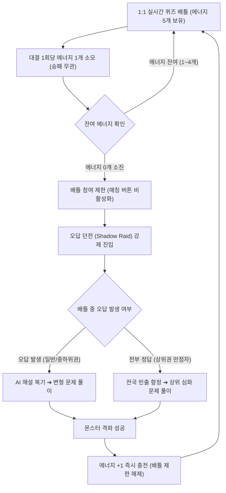

# 배틀스터디 (Battle Study) 게임 룰 명세서

## 1. 기본 대결 규칙 (Battle Arena)
- **방식**: 1:1 실시간 동기식 퀴즈 배틀
- **승패 판정**: 체력(HP 100) 기반 대결
  - 정답 제출: 상대방 HP -34 차감
  - 오답 제출: 본인 HP -34 차감
  - 타임어택 크리티컬: 제한 시간의 30% 이내 정답 시 데미지 2배 (-68)
- **승리 조건**: 상대방 HP를 먼저 0으로 만들거나, 문항 종료 시 잔여 HP가 더 높은 플레이어 승리
- **보상**: 승리 시 개인 승점(LP) 획득 및 소속 학교 랭킹 점수 합산 (에너지는 충전되지 않음)

---

## 2. 번개 에너지 및 복습 순환 시스템

### 핵심 원칙
- 배틀스터디는 과금(현질)이나 시간 경과에 따른 자동 충전이 일절 존재하지 않음.
- 에너지를 충전할 수 있는 유일한 수단은 **학습(오답 던전 클리어)** 단 하나뿐임.

### 4대 세부 규칙
1. **에너지 보유 및 소모**:
   - 최대 보유량: 5개
   - 승패와 관계없이 **대결 1회당 에너지 1개 무조건 소모**
2. **배틀 참여 제한 (방전)**:
   - 에너지 0개 소진 시 **신규 배틀 매칭 즉시 차단**
   - 복습 없는 무분별한 연속 게임 진행을 시스템적으로 원천 방지
3. **오답 던전(Shadow Raid) 수준별 분기**:
   - **오답이 있는 학생**: 배틀 중 틀린 문제의 AI 해설 복기 ➔ **변형 문제 풀이** ➔ 몬스터 격파
   - **오답이 없는 학생**: 전국 빈출 함정 문항 및 **단원별 상위 심화 문제 풀이** ➔ 몬스터 격파
4. **재충전 및 배틀 복귀**:
   - 던전 몬스터 1마리 격파 시 **에너지 +1 즉시 충전**
   - 배틀 참여 제한 즉시 해제 및 1:1 대결 재진입 가능

---

## 3. 에너지 선순환 구조도 (Mermaid)

---

## 4. 핵심 룰 요약표

| 구분 | 일반 모바일 게임 | 배틀스터디 (Battle Study) | 교육적 효과 |
| :--- | :--- | :--- | :--- |
| **에너지 충전 방식** | 유료 결제(현질) 또는 시간 경과 자동 충전 | **오직 오답 던전 학습 클리어** | 게임을 더 하기 위해 자발적 공부 강제 |
| **연승 시 처리** | 보너스 스태미나 지급으로 계속 게임 가능 | **연승해도 무조건 판당 1개 차감** | 상위권 학생의 독점 및 과몰입 원천 차단 |
| **에너지 0개 상태** | 대기 시간 발생 (이탈 유발) | **복습 던전 즉시 진입 유도** | 게임 몰입 에너지를 학업 성취로 직결 |
| **오답 없는 학생** | 무제한 연속 플레이 가능 | **상위 심화 킬러 문항 해결 필수** | 수준별 맞춤형 개별화 심화 학습 달성 |
