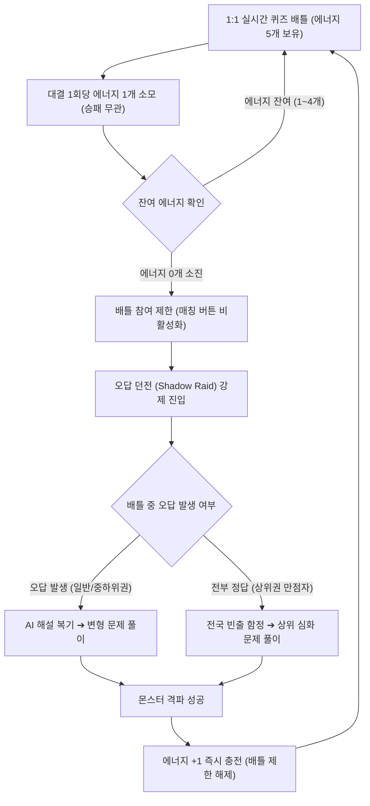

# 배틀스터디 (Battle Study) 게임 룰 명세서

## 1. 기본 대결 규칙 (Battle Arena)
- **방식**: 1:1 실시간 동기식 퀴즈 배틀
- **승패 판정**: 체력(HP 100) 기반 대결
  - 정답 제출: 상대방 HP -34 차감
  - 오답 제출: 본인 HP -34 차감
  - 타임어택 크리티컬: 제한 시간의 30% 이내 정답 시 데미지 2배 (-68)
- **승리 조건**: 상대방 HP를 먼저 0으로 만들거나, 문항 종료 시 잔여 HP가 더 높은 플레이어 승리
- **보상**: 승리 시 개인 승점(LP) 획득 및 소속 학교 랭킹 점수 합산 (에너지는 충전되지 않음)

---

## 2. 번개 에너지 및 복습 순환 시스템

### 핵심 원칙
- 배틀스터디는 과금(현질)이나 시간 경과에 따른 자동 충전이 일절 존재하지 않음.
- 에너지를 충전할 수 있는 유일한 수단은 **학습(오답 던전 클리어)** 단 하나뿐임.

### 4대 세부 규칙
1. **에너지 보유 및 소모**:
   - 최대 보유량: 5개
   - 승패와 관계없이 **대결 1회당 에너지 1개 무조건 소모**
2. **배틀 참여 제한 (방전)**:
   - 에너지 0개 소진 시 **신규 배틀 매칭 즉시 차단**
   - 복습 없는 무분별한 연속 게임 진행을 시스템적으로 원천 방지
3. **오답 던전(Shadow Raid) 수준별 분기**:
   - **오답이 있는 학생**: 배틀 중 틀린 문제의 AI 해설 복기 ➔ **변형 문제 풀이** ➔ 몬스터 격파
   - **오답이 없는 학생**: 전국 빈출 함정 문항 및 **단원별 상위 심화 문제 풀이** ➔ 몬스터 격파
4. **재충전 및 배틀 복귀**:
   - 던전 몬스터 1마리 격파 시 **에너지 +1 즉시 충전**
   - 배틀 참여 제한 즉시 해제 및 1:1 대결 재진입 가능

---

## 3. 에너지 선순환 구조도 (Mermaid)

---

## 4. 핵심 룰 요약표

| 구분 | 일반 모바일 게임 | 배틀스터디 (Battle Study) | 교육적 효과 |
| :--- | :--- | :--- | :--- |
| **에너지 충전 방식** | 유료 결제(현질) 또는 시간 경과 자동 충전 | **오직 오답 던전 학습 클리어** | 게임을 더 하기 위해 자발적 공부 강제 |
| **연승 시 처리** | 보너스 스태미나 지급으로 계속 게임 가능 | **연승해도 무조건 판당 1개 차감** | 상위권 학생의 독점 및 과몰입 원천 차단 |
| **에너지 0개 상태** | 대기 시간 발생 (이탈 유발) | **복습 던전 즉시 진입 유도** | 게임 몰입 에너지를 학업 성취로 직결 |
| **오답 없는 학생** | 무제한 연속 플레이 가능 | **상위 심화 킬러 문항 해결 필수** | 수준별 맞춤형 개별화 심화 학습 달성 |

---

## 5. 추가 기획 의도: 실력 기반 배치 및 승급 구조 (미구현)

> 본 섹션은 현재 시제품에 반영되지 않은 추가 기획 의도입니다. 현재 구현은 승리 시 LP +20, 패배 시 LP -15의 고정 가감 방식입니다.

### 5.1 설계 배경
- 로그인과 학년 인증 없이 입장하는 서비스 특성상, 학년 자기신고에 의존하지 않고 풀이 결과로 실력을 판단한다.
- 중학생과 고등학생이 모두 대상이므로, 학년이 아닌 실력 기준으로 문제 범위와 난이도를 정한다.

### 5.2 두 가지 점수의 분리
| 구분 | 레이팅 | LP |
| :--- | :--- | :--- |
| 역할 | 실력 측정, 문제 범위와 상대 선정 | 승급 진행도 표시 |
| 변동 | 상대 실력을 반영하여 변동 | 고정 폭 가감 |
| 공개 여부 | 비공개 | 공개 |

- 레이팅은 Elo 방식(Arpad Elo 제안, 국제체스연맹 채택)을 참고한다.
- K값(배치 판 40, 일반 판 20)과 레이팅 구간은 운영 데이터 확보 전까지 초기 가정값이며, 이후 보정한다.

### 5.3 개념 사다리 (수학)
- 수학은 중1부터 고3 과정까지 단일 개념 사다리로 구성한다.
- 고2 이후 선택 과목은 공통 줄기 이후 갈래로 처리한다.
- 문제 범위는 계급이 아닌 레이팅 기준 인접 단원으로 정한다. 계급은 표시 수단이며 출제의 입장 조건이 아니다.
- 국어와 영어는 개념 사다리 없이 문제별 난이도로만 관리한다.
- 문제 생성 시 단원 단계를 지정하고, 배치 판에서는 여러 단계에서 한 문항씩 섞어 출제한다. 오답 던전에서는 틀린 문제의 단계 태그로 복습 범위를 정한다.

#### 개념 사다리 단원표 (예시)

> 아래 표는 설명용 예시입니다. 실제 표는 2022 개정 교육과정 성취기준 코드 기준으로 작성하고, 학년 순서와 실제 난이도 순서의 차이를 검증하여 확정한다.

| 단계 | 단원 | 대략적 학년 | 대응 레이팅(예시) |
| :--- | :--- | :--- | :--- |
| 1 | 정수와 유리수 | 중1 | 400 이상 |
| 2 | 문자와 식, 일차방정식 | 중1 | 600 이상 |
| 3 | 좌표평면과 그래프 | 중1 | 800 이상 |
| 4 | 연립방정식 | 중2 | 900 이상 |
| 5 | 일차함수 | 중2 | 1,000 이상 |
| 6 | 이차방정식 | 중3 | 1,200 이상 |
| 7 | 이차함수 | 중3 | 1,300 이상 |
| 8 | 다항식, 방정식과 부등식 | 고1 | 1,400 이상 |
| 9 | 지수와 로그, 삼각함수 | 고2 | 1,600 이상 |
| 10 | 미분과 적분 | 고2 | 1,800 이상 |

### 5.4 배치와 게스트 배틀
- 중/고 선택은 최초 출제 범위의 기본 폭과 시작 위치만 결정한다.
- 처음 3판은 배치 판으로 운영하며, 폭넓은 단원을 출제하고 레이팅 변동 폭을 크게 둔다.
- 로그인 없이 시작하는 게스트 첫 배틀을 배치 판으로 사용한다.
- 게스트 결과는 브라우저 임시 저장으로 보관하고, 계정 등록 시 이어받는다.
- 결과 화면의 계정 등록 안내는 배치로 산정한 계급의 보존을 근거로 구성한다.

### 5.5 승급 흐름
1. 중/고 선택으로 시작 범위를 설정한다.
2. 배치 3판으로 시작 레이팅과 시작 계급을 산정한다.
3. 일반 배틀에서 승패에 따라 레이팅과 LP를 각각 갱신한다.
4. LP가 100에 도달하면 승급하며, 새로 열린 개념을 안내한다.

### 5.6 알려진 한계
- 인증이 없으므로 새 계정 생성을 통한 하위 계급 이용을 완전히 차단할 수 없다.
- 게스트는 새로고침으로 배치를 반복할 수 있다.
- 문제별 단계와 난이도 초기값은 AI 또는 교사 판정에 의존한다.
