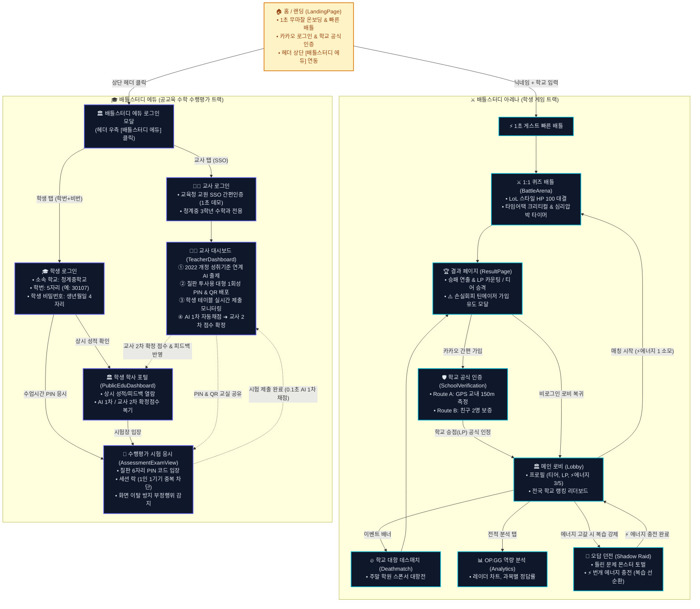

# ⚔️ 배틀스터디 (Battle Study Arena & Edu) 최신 서비스 플로우 도식화

> **문서 버전**: v2.0 (최신 배틀스터디 아레나 & 에듀 통합 아키텍처 반영)  
> **최종 수정일**: 2026-10-16  
> **목적**: 디미고 e-비즈니스과 특별전형 실적설명서, 심층면접 질의응답 및 청소년 창업 경진대회 시연용 전체 서비스 라이프사이클 도식화

---

## 🗺️ 1. 전체 서비스 라이프사이클 플로우차트 (Flowchart)

---

## 📌 2. 이전 버전 대비 핵심 고도화 포인트 (5대 차이점)

| 비교 항목 | 초기 기획 프로토타입 | ⚔️ 현재 최신 배틀스터디 (고도화 반영) | 비즈니스 & 교육적 의의 |
|:---|:---|:---|:---|
| **온보딩 & 진입** | 첫 화면에서부터 로그인/회원가입 강제 | **무마찰 1초 게스트 빠른 배틀** ➔ 재미 체감 후 손실 회피 가입 유도 | 전환율(Conversion Rate) 극대화, 이탈률 최소화 |
| **복습 강제 순환** | 오답 던전이 단순 별개 메뉴로 방치 | **번개 에너지(`⚡ 3/5`) 소모 시스템** ➔ 에너지가 0이면 **오답 던전 클리어 시에만 충전** | 공부를 지속하게 만드는 강력한 에듀테크 리텐션 루프 |
| **학교 대항전 인증** | 텍스트 단순 선택 (타교 사칭 및 담합 취약) | **GPS 교내 150m 측정** or **친구 2명 보증** 학교 공식 인증 모달 신설 | 신뢰할 수 있는 전국 중학교 랭킹 데이터 구축 |
| **에듀 학생 로그인** | 학년/반/번호 3분할 드롭다운 + 학교코드 | **학번(5자리) 단일 입력 + 비밀번호(생년월일 4자리)** ➔ 상시 성적 조회와 PIN 시험 응시(2-Way) 분리 | 타인 사칭 차단 & 방과 후 성적 상시 열람권 보장 |
| **교사 출제 & 채점** | 일반 아이디/비밀번호 로그인 | **교육청 교원 SSO 간편인증** + **칠판 투사용 대형 PIN/QR 모달** + **AI 1차 자동 ➔ 교사 2차 확정** | 공교육 현장 적합성 확보 및 교사 행정 업무 경감 |

---

## 🎮 3. 트랙별 핵심 화면 및 사용자 여정 (User Journey)

### ⚔️ [트랙 A: 배틀스터디 아레나 (학생 학습 게임)]

1. **랜딩 온보딩 (`/`)**:
   - 회원가입 절차 없이 닉네임과 학교 검색만으로 `[⏱️ 1초 빠른 배틀]` 진입.
   - 상단 헤더의 로고 클릭 시 언제든 홈으로 즉시 복귀.
2. **1:1 퀴즈 배틀 아레나 (`/battle`)**:
   - LoL 스타일 다크 테마, HP 100 대결, 타임어택 크리티컬(제한 시간 30% 이내 정답 시 2배 데미지).
   - 심리 압박 시뮬레이터(상대 완료 시 남은 시간 10초 단축 및 붉은 비네팅 경고).
3. **배틀 결과 & 틴에이저 가입 유도 (`/result`)**:
   - 승패 연출, LP 실시간 변동, 100 LP 달성 시 전체 화면 티어 승격 연출.
   - *"브라우저 닫으면 방금 딴 점수 다 날아가요!"* 손실 회피 기반 카카오 가입 유도 모달.
4. **메인 로비 (`/lobby`)**:
   - 프로필 카드(티어, LP, 번개 에너지, 학교 공식 인증 뱃지).
   - 1:1 매칭, 학교 대항 데스매치(주말 학원 스폰서 이벤트), 전국 학교 랭킹 리더보드.
   - 우측 상단 유저 아바타 드롭다운(성적 요약, 역량 분석 링크, 로그아웃).
5. **오답 던전 (`/shadow-raid`)**:
   - 내가 틀린 문제가 몬스터로 등장(맞춤법 구미호, 삼각함수 가고일 등).
   - 격파 시 번개 에너지(`⚡`) 즉시 충전.
6. **나의 역량 분석 (`/analytics`)**:
   - OP.GG 스타일 육각형 레이더 차트, 과목별 정답률, 경기 히스토리 분석.

---

### 🎓 [트랙 B: 배틀스터디 에듀 (공교육 수학 수행평가)]

1. **에듀 로그인 모달 (헤더 우측 `[🏛️ 배틀스터디 에듀]` 클릭)**:
   - **학생**: 학교(`청계중학교`) + 학번 5자리(`30107`) + 비밀번호(`0524`)
     - ⓐ `[학사 포털 입장 (성적/피드백 조회)]` ➔ `/public-edu`
     - ⓑ `[수업시간 1회성 시험 PIN으로 즉시 응시하기]` ➔ `/assessment-test?from=pin`
   - **교사**: `[🏛️ 교육청 교원 SSO 간편인증 (1초 데모 로그인)]` 원클릭 ➔ `/teacher`
2. **교사용 대시보드 (`/teacher`) (청계중 3학년 수학과 전용)**:
   - **기능 ① (AI 출제)**: 교과서 단원/페이지/난이도 입력 ➔ 2022 개정 성취기준 연계 객관식/서술형 자동 출제 ➔ `[수행평가 문제 최종 확정]`.
   - **기능 ② (PIN/QR 배포)**: 칠판 투사용 대형 모달 (6자리 PIN `MTH-7429` & 대형 QR 코드 생성).
   - **기능 ③ (학생 테이블)**: 학년, 반, 번호, 이름, 제출 상태 실시간 모니터링 및 다중 필터링.
   - **기능 ④ (2단계 채점)**: 학생 답안 제출 시 0.1초 AI 1차 자동 채점 ➔ 교사가 부분점수 가감/피드백 작성 후 `[선생님 2차 최종 점수 확정]`.
3. **학생 수행평가 시험지 (`/assessment-test`)**:
   - 흰색 클린 시험지 테마, 화면 이탈 감지 부정행위 방지 시스템, 1인 1기기 세션 락(Session Lock).
   - 제출 완료 시 교사용 대시보드로 실시간 동기화.
4. **학생 학사 포털 (`/public-edu`)**:
   - 방과 후/자습실에서 본인의 AI 1차 점수, 교사 최종 확정 점수, 성취기준 달성도 상시 열람.
