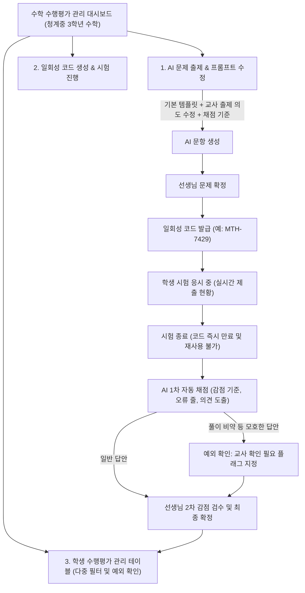

# [구현 계획] 수학 수행평가 관리 전용 교사용 대시보드 (MVP)

사용자 피드백을 반영하여 세특 관련 내용을 전면 삭제하고, docs/teacher.txt 요구사항에 맞춰 "수학 과목 전용 수행평가 관리"에만 100% 집중하도록 대시보드를 재구성한 MVP 구현 계획입니다.

---

## 1. 핵심 변경 방향 (수행평가 관리 및 감점 검수 체계 고도화)

1. **세특 관련 요소 완전 제거**:
   - 생기부 세특 분석 리포트, 추천 문장, NEIS 복사 버튼 등 세특 관련 기능 일체 삭제.
2. **수행평가 관리 전용 테이블로 재구성**:
   - 기존의 세특 조회용 학생 목록을 "수행평가 응시 현황 및 채점 관리 테이블"로 변경.
   - 이름, 학년, 반, 번호 컬럼 구성 및 각 컬럼별 검색/다중 필터링 기능 제공.
   - '교사 확인 필요' 플래그(풀이 비약/모호성 감지) 및 전용 필터 지원.
3. **수학 과목 단독 고정**:
   - 다과목 선택 UI 제거 -> 중3 수학과(Mathematics) 교사 전용 환경으로 고정.
4. **수행평가 End-to-End 라이프사이클 구현**:
   - [1단계] 출제 의도 맞춤 프롬프트 및 채점 기준 설정: 기본 템플릿 제공 및 교사 직접 수정 기능, 루브릭 감점 기준표 설정 -> AI 문항 출제 -> 문항별 배점 확인 및 확정.
   - [2단계] 일회성 코드 배포: 확정 후 일회성 코드(PIN) 생성 -> 학생 응시 진행 -> 시험 종료 시 코드 만료(재사용 불가).
   - [3단계] 2단계 평가 (AI 감점 항목 집중 검수 -> 교사 직접 확정): 학생 제출 답안에 대해 AI 1차 자동 채점(미충족 감점 기준, 오류 답안 줄, AI 검토 의견) -> 모호한 답안 교사 확인 필요 플래그 -> 교사가 AI 근거 바탕으로 최종 점수와 감점 폭 직접 결정 및 확정.

---

## 2. 대시보드 화면 구조 및 기능 흐름 (MVP)

---

## 3. 상세 컴포넌트 설계 (`TeacherDashboard.tsx`)

### 1) 상단 헤더 및 현황 요약
- 타이틀: 청계중학교 3학년 수학과 수행평가 관리 대시보드 (수학 과목 단독 고정)
- 수행평가 현황 요약:
  - 현재 평가 단원: 2026학년도 1학기 수학 수행평가 - 제곱근과 실수
  - 응시 현황: 제출 완료 학생 수 실시간 카운트
  - 채점 상태 칩: 최종 확정 완료, 가채점 대기, 교사 확인 필요(예외 감지) 건수 실시간 연동

### 2) [기능 1] 출제 의도 맞춤 프롬프트 수정 및 채점 기준 설정
- 기본 프롬프트 템플릿 기본 제공:
  - 출제 목적, 문항 구성, 서술형 세부 지침이 구조화된 표준 템플릿 탑재.
  - 교사가 출제 의도에 맞게 문구를 자유롭게 편집 가능하며, '기본 템플릿 복원' 버튼 지원.
- 교사 직접 설정 채점 기준표 (루브릭):
  - 각 문항별 배점, 계산 부호 실수 감점폭, 중근 누락 감점폭 등 감점 원칙을 교사가 직접 기입.
- 성취기준 연계 자동 출제:
  - 교과서 단원(목차), 페이지 범위, 문항 수, 난이도(하/중/상) 설정 후 문항 생성.
  - 객관식 및 서술형 문항 검토 후 [수행평가 문항 최종 확정] 버튼 클릭.

### 3) [기능 2] 일회성 시험 코드 배포 및 만료 관리
- 문제 확정 후 일회성 시험 코드(PIN) 생성 (예: MTH-7429).
- 교실 칠판/빔프로젝터 전체화면 투사 모드(대형 핀코드 및 QR 안내).
- [시험 종료 및 코드 만료] 클릭 시 코드는 즉시 만료(EXPIRED)되어 영구 재사용 차단.

### 4) [기능 3] 학생 수행평가 관리 테이블 및 예외 확인 필터
- 테이블 구성 컬럼:
  - 학년, 반, 번호, 이름, 응시 상태, 1차 가채점, 교사 2차 확정 점수, 평가 상태, 채점 및 조정 버튼.
- 평가 상태 배지:
  - 최종 확정(남색), AI 1차 완료(연두/노랑), 교사 확인 필요(주황색 Alert 배지), 미응시(회색).
- 다중 필터링 지원:
  - 학급(반) 선택 (전체, 1반, 2반, 3반)
  - 채점 및 평가 상태 필터 (전체, 최종 확정, 가채점 대기, 교사 확인 필요, 미응시)
  - 번호 검색 및 학생 이름 실시간 검색

### 5) [기능 4] AI 채점 지원: 감점 항목 집중 검수 모달 및 교사 직접 확정
- 학생 행의 [채점/확정] 버튼 클릭 시 모달 오픈.
- [예외 확인 플래그]:
  - 풀이 비약 등 모호한 답안에 대해 "풀이 비약 감지: AI 단독 판정이 모호하므로 교사의 직접 검토가 필요합니다" 상단 경고 배너 표시.
- [감점 항목 집중 검수 리포트 3단 카드]:
  - 1. 미충족 감점 기준: 적용된 루브릭 항목 명시
  - 2. 오류 답안 줄 (Line): 오류가 발생한 구체적 수식 위치 명시
  - 3. AI 검토 의견: 부분점수 및 감점 타당성 분석 제시
- [교사 직접 확정]:
  - AI가 짚어준 근거를 바탕으로 각 문항별 점수 및 총점을 교사가 직접 가감(+ / -) 조정.
  - 교사 평가 의견 입력 후 [최종 점수 및 감점 폭 확정 저장] 클릭 시 확정 완료.

## 서술형 손글씨 풀이 제출 및 디지털 변환

1. 학생 시험 화면의 서술형 풀이 입력은 필기 캔버스로 대체한다. 펜, 터치, 마우스로 작성하며 되돌리기와 전체 지우기를 지원한다.
2. [필기 제출]을 누르면 약 1.5초의 변환 과정을 거쳐 디지털 텍스트로 변환한다. 현재는 백엔드와 API 키 없이 문항별 사전 정의 텍스트를 사용하는 Mock OCR이며, 실서비스에서는 OCR API로 교체한다.
3. 변환 결과는 원본 필기 이미지 옆에 읽기 전용으로 표시하며, 학생이 직접 수정할 수 없다. 오류가 있으면 [다시 쓰기]로 재작성한다.
4. 첫 변환에서 비슷하게 생긴 글자 한 개를 확인 필요 글자로 표시한다. 학생이 확인하거나 다시 쓰기를 하지 않으면 최종 제출이 차단된다.
5. 문항별 잠금은 없으며, 최종 제출 시점에 모든 답안이 제출완료(수정 불가)로 확정된다.
6. 교사 채점 화면에는 학생 손글씨 원본, 변환 텍스트, 학생 확인 및 제출 시각을 함께 표시한다. AI 감점 표시는 변환 텍스트의 줄 기준으로 유지한다.
