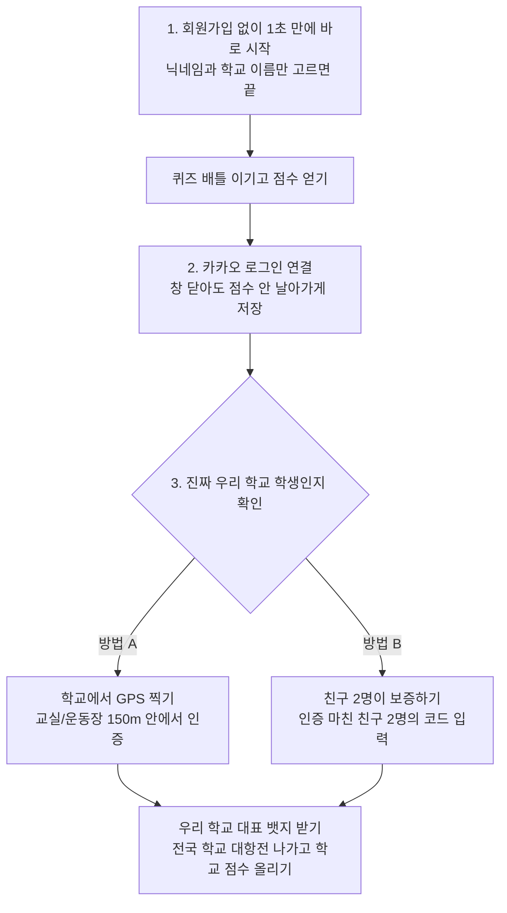
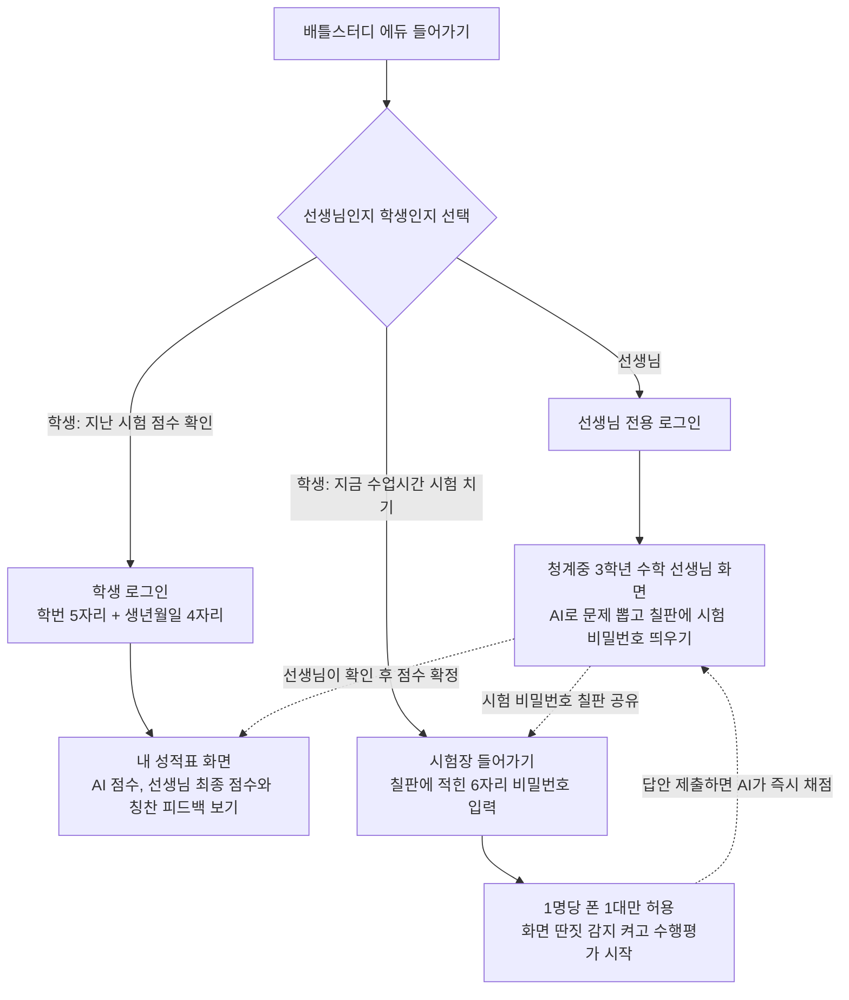

# 배틀스터디 로그인 및 학교 인증 순서도

> 문서 버전: v1.1 (중학교 3학년 눈높이 수정판)  
> 최종 수정일: 2026-10-17  
> 문서 목적: 배틀스터디 게임(아레나)과 학교 수학 수행평가(에듀)의 로그인 및 본인 인증 진행 순서를 누구나 쉽게 이해할 수 있도록 정리한 문서

---

## 1. 개요: 게임과 학교 시험의 차이점

배틀스터디는 친구들과 재미있게 공부하는 **게임(아레나)**과 실제 수업 시간에 쓰는 **학교 수행평가(에듀)** 두 가지로 나뉘어 있어, 들어가는 방법과 지켜야 할 규칙이 다릅니다.

| 구분 | 1. 배틀스터디 아레나 (친구들과 퀴즈 배틀) | 2. 배틀스터디 에듀 (수학 수행평가) |
|:---|:---|:---|
| **가장 중요한 목표** | 회원가입 귀찮아서 도망가지 않게 1초 만에 배틀 시작 | 시험 부정행위 막기, 진짜 우리 반 학생만 안전하게 시험 보기 |
| **로그인 방법** | 3단계 순서대로 진행 (이름만 입력 -> 카카오 저장 -> 학교 인증) | 선생님과 학생 2가지 길 (선생님 로그인 / 학생 성적 확인 or 시험 응시) |
| **안전장치** | 학교 위치 150m 안에서 GPS 찍기, 같은 학교 친구 2명이 보증 | 1명당 폰/컴퓨터 1대만 접속 허용, 칠판 6자리 비밀번호(PIN) |

---

## 2. 배틀스터디 아레나(게임) 인증 진행 순서

친구들이 가입하기 귀찮아서 그냥 나가지 않도록, 먼저 1초 만에 퀴즈 배틀을 즐기게 한 다음 점수를 잃어버리지 않도록 카카오 계정에 저장하게 만들었습니다.

### 2.1 아레나 한눈에 보는 순서도

### 2.2 각 단계별 쉬운 설명

1. **1단계: 회원가입 없이 바로 배틀**
   - 아이디나 비밀번호를 만들 필요 없이, 닉네임과 학교 이름만 검색해서 고르면 1초 만에 퀴즈 배틀 방에 들어갑니다.
   - 첫 판을 플레이하는 동안에는 인터넷 창에 점수가 임시로 기억됩니다.
2. **2단계: 카카오로 내 점수 안전하게 저장하기**
   - 배틀이 끝나고 승리해서 얻은 점수(LP)를 확인한 뒤, 카카오 버튼을 한 번 눌러 계정을 만듭니다.
   - 이렇게 해두면 컴퓨터나 폰을 꺼도 내가 올린 랭킹 점수가 영구적으로 저장됩니다.
3. **3단계: 진짜 우리 학교 학생인지 확인받기**
   - 다른 학교 학생이 우리 학교 이름을 사칭해서 가짜 점수를 올리거나 장난치는 것을 막기 위해 2가지 방법 중 하나를 선택합니다.
   - **방법 A (운동장/교실 GPS 인증)**: 스마트폰 위치 기능을 켜서 진짜 우리 학교 150m 근처에 있는지 확인합니다.
   - **방법 B (친구 2명이 보증해주기)**: 이미 학교 인증을 마친 같은 학교 친구 2명에게 받은 코드를 입력해서 신원을 확인받습니다.

---

## 3. 배틀스터디 에듀(학교 시험) 인증 진행 순서

학교 수학 수행평가 점수로 들어가는 곳이므로, 선생님과 학생의 역할을 확실히 나누고 남이 대신 시험을 쳐주는 부정행위가 일어나지 않도록 꼼꼼하게 만들었습니다.

### 3.1 에듀 한눈에 보는 순서도

### 3.2 각 단계별 쉬운 설명

1. **선생님 전용 화면**
   - 시도 교육청 교원 인증을 통해 선생님만 들어갈 수 있습니다.
   - 청계중학교 3학년 수학 교과서 범위에 맞게 AI로 문제를 만들고, 검토 후 확정하면 칠판에 띄울 6자리 시험 비밀번호(예: `MTH-7429`)가 나옵니다.
2. **학생 성적표 화면 (학번 + 생년월일 로그인)**
   - 방과 후나 집에 가서 내 점수를 편하게 확인할 수 있는 곳입니다.
   - 다른 친구가 내 점수를 몰래 보면 안 되므로, 학번 5자리(예: `30107`)와 비밀번호(생년월일 4자리)를 입력해야 들어갈 수 있습니다.
3. **수업시간에 시험 치기 (칠판 6자리 번호로 바로 입장)**
   - 수업 시간에는 복잡하게 아이디/비번을 칠 시간이 없으므로, 선생님이 칠판에 적어주신 6자리 시험 비밀번호만 치면 바로 시험이 시작됩니다.
   - **대리시험 방지 (1명당 기기 1대만 허용)**: 한 학생의 학번으로 두 대 이상의 폰이나 태블릿이 동시에 들어오는 것을 막아 친구가 대신 시험 쳐주는 부정행위를 차단합니다.
   - **시험 끝난 뒤 코드 영구 잠금**: 시험 시간이 끝나서 선생님이 종료 버튼을 누르면 그 6자리 비밀번호는 완전히 만료되어, 나중에 시험지가 새어나가거나 다시 들어갈 수 없습니다.

---

## 4. 게임 점수와 진짜 학교 성적의 완전 분리

1. **게임 점수와 학교 성적은 절대 섞이지 않습니다**:
   - 아레나 게임에서 딴 랭킹 점수(LP)나 티어는 게임 안에서만 쓰이며, 학교 생활기록부나 실제 수학 수행평가 점수에는 절대로 영향을 주지 않습니다.
2. **시험 칠 때는 게임으로 도망갈 수 없습니다**:
   - 시험을 치르는 도중에는 인터넷 창을 다른 곳으로 바꾸거나 게임 모드로 넘어가지 못하도록 부정행위 감지 시스템이 작동합니다.
