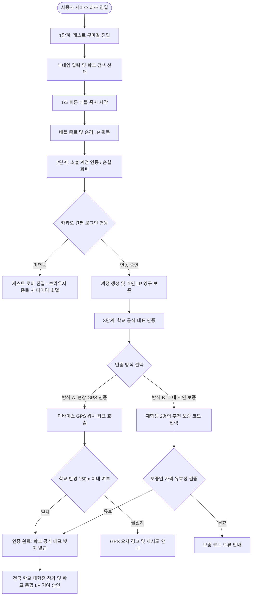
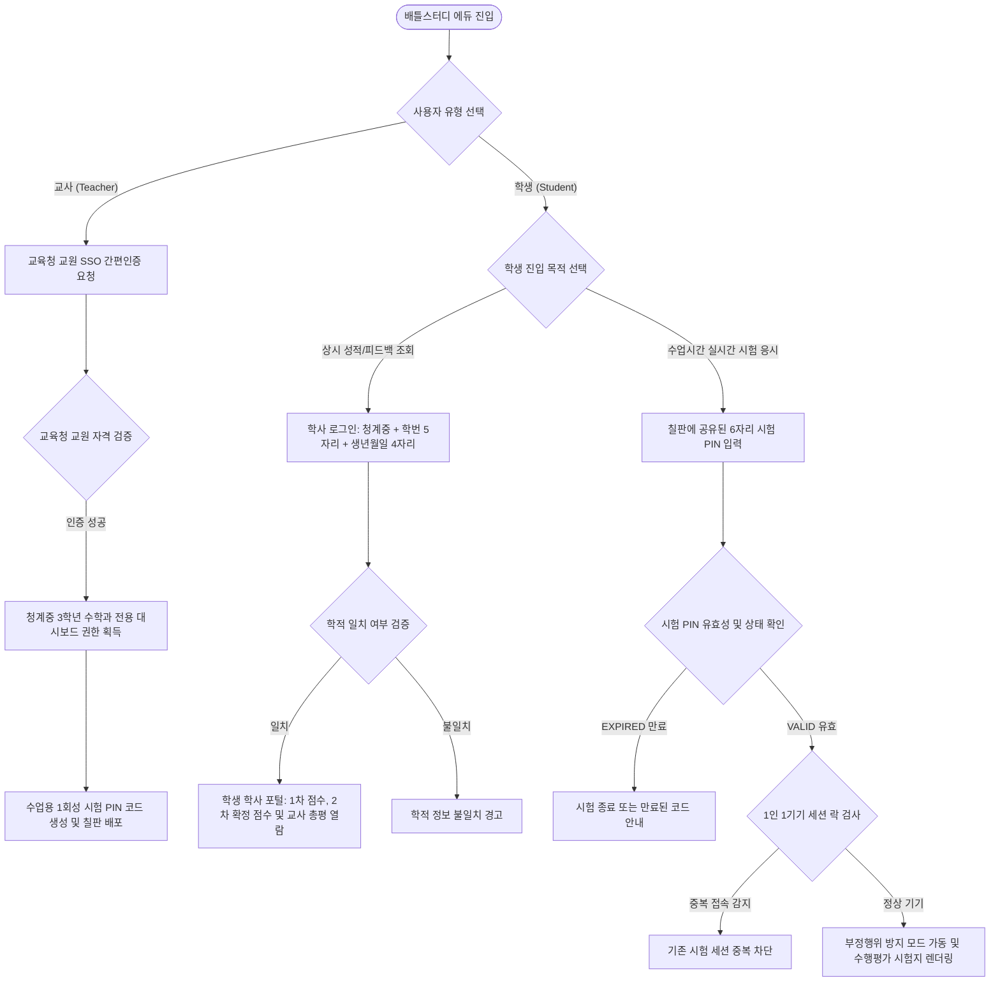

# 배틀스터디 인증 모듈 아키텍처 및 순서도

> 문서 버전: v1.0  
> 최종 수정일: 2026-10-17  
> 문서 목적: 배틀스터디(Battle Study) 서비스의 아레나(B2C 게임 트랙) 및 에듀(B2G 공교육 트랙) 인증 모듈 라이프사이클 정의 및 순서도 도식화

---

## 1. 개요 및 트랙별 인증 전략 비교

배틀스터디의 인증 모듈은 서비스의 타겟과 이용 시나리오에 따라 상이한 보안 등급과 진입 플로우를 적용합니다.

| 구분 | 트랙 A: 배틀스터디 아레나 (B2C) | 트랙 B: 배틀스터디 에듀 (B2G) |
|:---|:---|:---|
| **핵심 목표** | 무마찰 진입(Conversion) 및 타교 사칭 차단 | 학적 정보 보호, 대리시험 원천 차단, 교원 권한 엄격 분리 |
| **인증 구조** | 3단계 순차 진화형 인증 (게스트 -> 소셜 -> 학교 공식 인증) | 사용자 유형별 2-Way 분기형 인증 (교원 SSO / 학생 학사 or 시험 PIN) |
| **보안 특화 장치** | 디바이스 GPS 반경 150m 검증, 재학생 2인 상호 보증 | 1인 1기기 세션 락(Session Lock), 1회성 만료 시험 PIN |

---

## 2. 아레나 트랙 인증 라이프사이클 (B2C 게임)

아레나 트랙은 청소년 사용자의 초기 이탈을 방지하기 위해 가입 절차 없이 즉시 배틀을 경험하게 한 뒤, 획득한 전적(LP)의 손실 회피 심리를 활용하여 정식 인증을 유도합니다.

### 2.1 인증 순서도

### 2.2 상세 단계별 정의

1. **1단계: 게스트 무마찰 온보딩 (Frictionless Onboarding)**
   - 아이디, 비밀번호, 본인 인증 절차 없이 닉네임과 학교 검색 자동완성만으로 즉시 배틀 룸 입장.
   - 브라우저 로컬 스토리지에 임시 세션 키를 생성하여 1차 배틀 진행.
2. **2단계: 손실 회피 기반 소셜 계정 연동 (Social Sign-in)**
   - 배틀 완료 후 승리 보상 및 LP 획득 화면에서 안내 팝업 제공.
   - 카카오 간편 OAuth 2.0 연동을 통해 브라우저 세션 만료 시에도 전적 데이터가 영구 보존되도록 전환.
3. **3단계: 학교 공식 대표 인증 (School Verification)**
   - 타 학교 사칭 및 부정한 랭킹 어뷰징을 원천 차단하기 위한 2중 인증 옵션 제공.
   - **방식 A (위치 기반 GPS 인증)**: 사용자의 현재 GPS 좌표를 수신하여 나이스(NEIS) 학교 표준 좌표 반경 150m 이내인지 대조 검증.
   - **방식 B (재학생 2인 보증 추천)**: 이미 해당 학교 인증을 완료한 재학생 2인의 고유 보증 코드를 입력받아 교내 네트워크 신원 확인.

---

## 3. 공교육 에듀 트랙 인증 라이프사이클 (B2G 평가)

공교육 에듀 트랙은 현직 교사의 평가 권한과 학생의 정규 학사 평가 신뢰성을 보장하기 위해 엄격한 역할 분리 및 세션 제어를 수행합니다.

### 3.1 인증 순서도

### 3.2 상세 단계별 정의

1. **교원 전용 인증 (Teacher Authentication)**
   - 공교육 현장 적합성을 위한 시도 교육청 교원 SSO 연동 구조 채택.
   - 시연 및 평가 환경에서는 단일 클릭 데모 인증을 지원하며, 교원 권한 확인 후 청계중학교 3학년 수학과 수행평가 관리 권한 부여.
   - 출제 문제 확정 시 수업용 대형 1회성 PIN 코드(예: `MTH-7429`)를 발급.
2. **학생 상시 학사 포털 인증 (Student Academic Portal)**
   - 학생 본인의 성적, AI 1차 자동 채점 결과, 교사 2차 확정 점수 및 서술형 피드백을 방과 후에도 상시 열람할 수 있도록 지원.
   - 소속 학교(청계중학교) + 학번 5자리(예: `30107`) + 비밀번호(생년월일 4자리) 검증을 통해 타인의 개인정보 열람을 엄격히 방지.
3. **수업시간 실시간 시험 응시 인증 (In-Class Assessment)**
   - 수업 시간 중에는 복잡한 로그인 과정 없이 선생님이 칠판/프로젝터에 띄운 1회성 시험 PIN 6자리 입력만으로 즉시 시험장 입장.
   - **세션 락(Session Lock)**: 동일 학생 학번으로 복수 기기 동시 접속 시 기존 세션을 차단하여 대리 응시 방지.
   - **PIN 영구 만료(Expired)**: 교사가 대시보드에서 `[시험 종료 및 코드 만료]` 버튼을 누르는 즉시 PIN 상태가 `EXPIRED`로 전환되어 시험지 추가 유출 및 사후 응시 원천 차단.

---

## 4. 트랙 간 전환 및 데이터 격리 원칙

1. **독립된 보안 도메인 유지**:
   - 아레나(게임) 트랙의 승패, LP, 랭킹 정보는 공교육 에듀 트랙의 실제 학교 내신 및 수행평가 성적에 일절 영향을 주지 않도록 완벽히 데이터 격리.
2. **상단 글로벌 내비게이션 연동**:
   - 학생 사용자는 상단 헤더의 단일 전환 버튼을 통해 게임 모드와 학사 관리 포털을 자유롭게 오갈 수 있으며, 평가 응시 중에는 화면 이탈 경고 시스템을 통해 게임 모드로의 무단 이탈을 방지.
