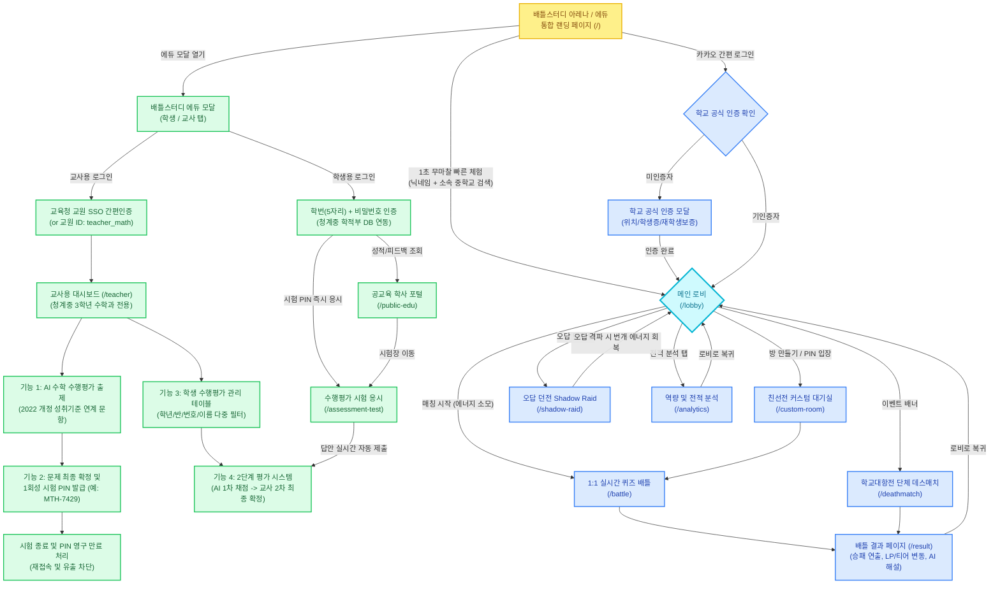

# 배틀스터디(Battle Study) 주요 기능 구조도

---

## 주요 기능별 1줄 핵심 요약

### 1. 배틀스터디 아레나 (학생 게이밍 트랙)
- **무마찰 진입(Frictionless Onboarding)**: 회원가입 절차 없이 닉네임과 학교 검색 자동완성만으로 1초 만에 서비스를 시작합니다.
- **카카오 계정 연동 및 학교 공식 인증**: 소속 학교의 공식 인증(GPS 위치, 학생증 OCR, 재학생 친구 보증)을 거쳐 학교 대표 자격을 획득합니다.
- **메인 로비 및 전국 학교 대항전 랭킹**: 개인 승점(LP)이 소속 학교 랭킹으로 누적되어 학교 간 명예를 걸고 경쟁하는 로비 환경을 제공합니다.
- **번개 에너지 시스템**: 배틀 참가 시 1개씩 소모되며, 오답 던전(Shadow Raid)을 클리어해야 충전되는 강력한 복습 강제 순환 루프입니다.
- **1:1 실시간 퀴즈 배틀 아레나**: 정답 속도와 정확도에 따라 상대 HP를 차감하여 승패를 가르는 LoL 스타일 다크 테마 대전 화면입니다.
- **타임어택 크리티컬 및 심리 압박 시뮬레이터**: 제한 시간 30% 이내 정답 시 데미지 2배, 상대 선제 풀이 시 남은 시간 단축 및 화면 붉은 진동으로 실전 시험장 수준의 몰입감을 유도합니다.
- **학교 대항전 단체 데스매치**: 팀 A 대 팀 B 간 실시간 줄다리기 체력 게이지와 팀원들의 풀이 현황 토스트 알림을 지원하는 단체전 모드입니다.
- **친선전 커스텀 룸**: 6자리 핀코드를 발급받아 친구나 학급 학우끼리 1:1 친선 대결을 진행하는 비공개 룸입니다.
- **오답 던전(Shadow Raid)**: 배틀에서 틀렸던 문제가 몬스터로 등장하며, 오답 격파 시 번개 에너지와 LP를 회복하는 복습 콘텐츠입니다.
- **배틀 결과 및 승급 연출**: 승패 연출, LP 변동 카운팅, 100LP 돌파 시 전체 화면 티어 승격 연출 및 문항별 정답 복기 아코디언을 제공합니다.
- **전적 및 역량 분석(Player Analytics)**: OP.GG 스타일로 과목별 정답률, 최근 경기 전적, 6대 핵심 역량 지표 레이더 차트를 분석합니다.

### 2. 배틀스터디 에듀 (공교육 수학 수행평가 트랙)
- **교육청 교원 SSO 간편인증**: 공교육 교원 신분 인증을 통해 단 1초 만에 안전하게 교사용 평가 관리 시스템으로 진입합니다.
- **청계중 3학년 수학과 전용 고정 환경**: 다과목 분산 없이 청계중학교 3학년 수학과 교육과정에 최적화된 평가 환경을 단독 제공합니다.
- **[기능 1] AI 수학 수행평가 문항 출제**: 교과서 단원, 페이지 범위, 난이도를 바탕으로 2022 개정 교육과정 성취기준 코드([9수01-01] 등)와 연계된 문항을 자동 생성합니다.
- **[기능 2] 문제 최종 확정 및 1회성 PIN 발급**: 교사가 검토 후 문제를 확정하면 교실 빔프로젝터 투사용 대형 일회성 시험 PIN(예: MTH-7429)을 발급합니다.
- **시험 종료 시 PIN 영구 만료 처리**: 시험 종료 버튼 클릭 즉시 코드가 영구 만료(EXPIRED)되어 시험 종료 후 재접속 및 문제 유출을 원천 차단합니다.
- **실시간 제출 현황 모니터링**: 시험 진행 중 전체 응시 대상자 대비 답안 제출 완료 학생 수와 진행률을 실시간 프로그레스 바 형태로 확인합니다.
- **[기능 3] 학생 수행평가 관리 테이블**: 학년, 반(1~3반), 번호(1~30번), 이름, 평가 상태별 다중 실시간 검색 및 필터링을 지원하는 통합 응시자 관리 테이블입니다.
- **[기능 4] 2단계 평가 시스템**: 학생 답안 제출 즉시 AI가 0.1초 만에 1차 채점(부분점수/근거 산출)하고, 선생님이 세부 검토 후 점수 가감/조정 및 피드백을 작성해 최종 확정합니다.
- **수행평가 시험 응시 뷰 (화이트 시험지 모드)**: 화려한 게임 효과를 배제하고 공정한 시험 환경을 위해 닉네임 익명화(Student A/B) 및 화면 이탈 경고 배너를 상시 노출합니다.
- **공교육 학생 학사 포털**: 학생이 본인 학번(5자리)과 비밀번호로 로그인하여 교사가 최종 승인한 수행평가 점수, 문항별 채점 결과, 교사 맞춤 피드백을 열람합니다.

---

## 메뉴별 직접 접속 URL 패스 (Direct URL Paths)

| URL 경로 | 해당 화면 및 기능 | 기본 진입 프로필 |
| :--- | :--- | :--- |
| **`/`** | 통합 랜딩 페이지 (온보딩 빠른 체험, 카카오 로그인, 에듀 모달 호출, 시연 바로가기) | 비로그인 (선택 시 닉네임/학교 입력) |
| **`/lobby`** | 학생 메인 로비 (ARENA 탭, 학교 랭킹, 에너지 현황, 티어/LP, 핀코드 입장) | 슈크림먹은빵 · 청계중학교 (실버 85LP) |
| **`/battle`** | 1:1 실시간 퀴즈 배틀 아레나 (국어/영어/수학 실시간 대전) | 슈크림먹은빵 · 청계중학교 |
| **`/deathmatch`** | 학교 대항전 단체 데스매치 (단체 줄다리기 체력전) | 슈크림먹은빵 · 청계중학교 |
| **`/shadow-raid`** | 오답 던전 (오답 몬스터 토벌 및 번개 에너지 충전) | 슈크림먹은빵 · 청계중학교 |
| **`/analytics`** | 역량 및 전적 분석 (OP.GG 스타일 전적 분석 및 역량 지표) | 슈크림먹은빵 · 청계중학교 |
| **`/custom-room`** | 친선전 커스텀 대기실 (학급/친구 1:1 대전 핀코드 대기) | 슈크림먹은빵 · 청계중학교 |
| **`/result`** | 배틀 결과 페이지 (승패 연출, LP/티어 변동, AI 오답 복기) | 슈크림먹은빵 · 청계중학교 |
| **`/teacher`** | 교사용 대시보드 (청계중 3학년 수학 수행평가 출제, PIN 관리, 2단계 채점) | 청계중학교 3학년 수학과 전용 |
| **`/public-edu`** | 공교육 학생 학사 포털 (수행평가 점수, 성취도, 교사 피드백 조회) | 박윤하 · 청계중학교 3학년 1반 7번 |
| **`/assessment-test`** | 공교육 수행평가 시험 응시 뷰 (화이트 시험지 모드, 부정행위 방지) | 청계중학교 3학년 수행평가 응시자 |

단축 URL 리다이렉트 지원:
- `/arena` ➔ `/lobby` 자동 이동
- `/raid`, `/dungeon` ➔ `/shadow-raid` 자동 이동
- `/teacher-dashboard` ➔ `/teacher` 자동 이동
